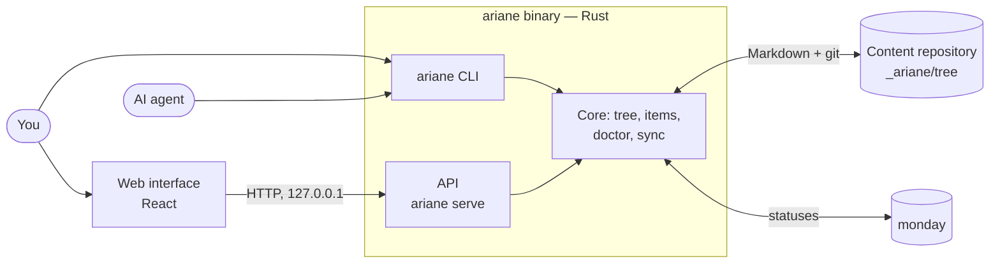

# Ariane

> [!IMPORTANT]
> **Ariane is looking for contributors.** It is meant to become a community project, not a personal one: anyone is welcome to use it, question it and improve it.
>
> - **Start with an issue** — a bug, a question, an idea, or a decision you disagree with.
> - **Then a pull request.** `make check` runs what the CI runs.
> - **What frames a contribution today:** the [specification](SPEC.md) and the [design decisions](docs/adr/) (ADRs). A change to a decision goes through a new ADR, `Proposed` first.
>
> The license, a contribution guide and a short statement of the project's principles are still being chosen. Until they exist, the code carries no license: open an issue before investing in a large change.

> Ariadne's thread through your projects.

**Ariane** is a file-based, hierarchical project management method, built to be read and operated by AI agents as much as by humans.

Your plans, stories, tasks and decisions are Markdown files in **one private git repository** — your content repository — organized as a tree that mirrors your projects: home, then projects, then repositories, as deep as you need. Each item carries a small versioned header (status, size, impact, parent…) that tools can read. The `ariane` binary validates that tree, serves an interface over it, and keeps it in step with an external tracker.

## Getting started

Ariane runs on macOS and Linux.

### 1. Install

There is no published release yet, so Ariane is installed from a checkout. You need [Rust](https://rustup.rs/) (stable), [Node.js](https://nodejs.org/) with [pnpm](https://pnpm.io/), and git.

```sh
git clone https://github.com/slashome/ariane.git
cd ariane
make install        # builds the interface, then installs `ariane` into ~/.cargo/bin
ariane --version
```

`make` alone lists every target.

### 2. Create your content repository

A content repository is a git repository with a `tree/` directory at its root. `tree/` is your home node; every directory below it is a node.

```sh
mkdir -p ~/_ariane/tree/perso/tasks
cd ~/_ariane && git init
```

Tell Ariane where it lives, so that every command finds it from any directory:

```sh
ariane config init --repo ~/_ariane
```

### 3. Write a first item

An item is a Markdown file whose name starts with its id. Its kind comes from its directory (`tasks/`, `stories/`, `epics/`, `reflexions/`, `ressources/`):

```markdown
<!-- ~/_ariane/tree/perso/tasks/T001-try-ariane.md -->
---
ariane: 1
node: perso
id: T001
title: Try Ariane
status: todo
---

Follow the README up to the interface.
```

```sh
ariane tasks          # perso  T001  todo  Try Ariane
ariane doctor         # doctor: healthy
cd ~/_ariane && git add -A && git commit -m "First item"
```

`ariane schema` prints every header key; [SPEC.md](SPEC.md) defines them, and what a `node.toml` adds to a node (a description, a status workflow, people, personas).

### 4. Open the interface

```sh
ariane serve --open   # http://127.0.0.1:27317
```

To keep it running in the background, at login and after a crash: `ariane service install`.

### 5. Work from your repositories (optional)

A node is **materialized** in the repository it describes by a symlink named `_ariane`. Ignore that name once, in your global git excludes, so that it never shows up in a team's repository:

```sh
# ~/.config/git/ignore is git's default; use the file core.excludesFile names, if you set one.
mkdir -p ~/.config/git && echo _ariane >> ~/.config/git/ignore
ln -s ~/_ariane/tree/perso/my-app ~/code/my-app/_ariane
```

From `~/code/my-app`, every command is then scoped to that node.

## What you get

- **A tree of projects.** Any node holds its own items, and inherits its parents' workflow, people and personas. Nothing is deleted: finished work moves to `archives/`.
- **A dashboard and boards.** The interface shows each node's tasks, stories and epics, a kanban that moves them across the workflow, a backlog, and an epic's progress.
- **Size × impact.** Items carry a size (`XS`…`XL`) and an impact; a matrix places them to show what is cheap and worth it.
- **Waiting on people.** An item that waits for a review or an answer names whom, why and since when, so the interface can list what is stuck on someone.
- **A health check.** `ariane doctor` reports what breaks the specification, and `ariane migrate` and `ariane fix` repair it — dry runs unless `--apply`.
- **Sync with monday.** A node bound to a monday board sends its items' statuses there, and refuses to guess when both sides changed.
- **Branches and pull requests on their item.** With the Claude Code hook, the branches and pull requests created while working on an item are recorded in it.
- **Local names for your dev servers.** `ariane proxy` serves the interface at `http://ariane.local`, and each node's dev server at its own name.
- **An agent.** [Ariane](agents/ariane/AGENT.md), the guide, answers "where are we, what's next" from the tree and operates the lifecycle. Its Claude Code adapter is in [`adapters/claude/`](adapters/claude/).

## Commands

Each command describes itself with `ariane <command> --help`; `ariane --help` lists them all.

| Command | What it does |
|---|---|
| `tasks`, `search`, `show` | List, find and read items |
| `doctor`, `migrate`, `fix` | Check the tree against the specification, and repair it |
| `schema` | Print the item header schema |
| `serve`, `service` | Serve the interface, in the foreground or as a background service |
| `config`, `settings` | The machine's configuration, and the settings versioned with the content |
| `pull` | Fast-forward the content repository to its upstream |
| `people` | Declare the people items wait for |
| `connect`, `sync` | Store a tracker's token, and send the items' statuses to it |
| `focus`, `hook`, `links` | Tie an agent session's branches and pull requests to an item |
| `proxy` | Reach the interface and the dev servers by name |

## How it works

One Rust codebase. The command line and the HTTP API that `ariane serve` exposes are two interfaces over the same code; the web interface, written in React and embedded in the binary, is a client of that API. The content repository is the only storage, and monday is an external tracker.



## Learn more

- [SPEC.md](SPEC.md) — the item header and `node.toml`, normatively.
- [docs/adr/](docs/adr/) — every design decision, with the alternatives rejected and why.
- [PLAN.md](PLAN.md) — the founding plan; the ADRs supersede parts of it.

## Develop

`make check` runs every check the CI runs: format, clippy and tests on the Rust side; typecheck, lint, Feature-Sliced Design and tests on the front. `make release VERSION=x.y.z` tags a release, which the CI builds and publishes to the Homebrew tap.

## License

Not chosen yet — see the note at the top.
